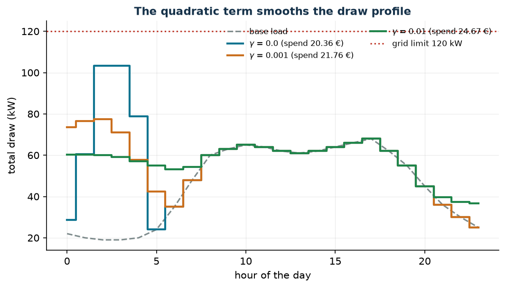
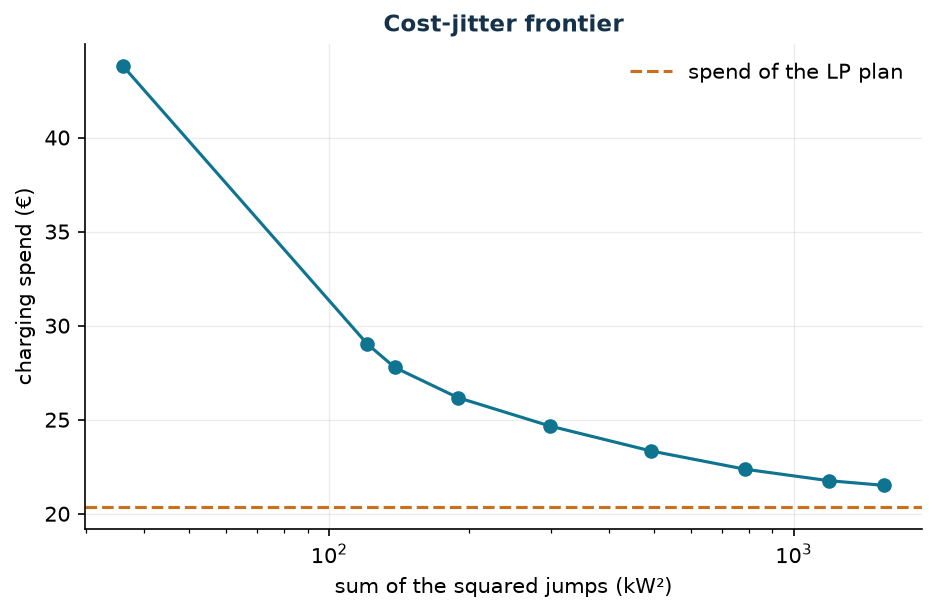

# Electric vehicle charging with a smooth profile

[:material-file-pdf-box: Lecture notes (PDF)](pdf/nlp-modelling-notes.pdf) · [:material-presentation: Chapter slides (PDF)](pdf/slides-10-ev-charging-quadratic.pdf) · [:material-pencil: Exercises](#exercises)

**Class:** convex QP · **Script:** `python/lab10_ev_charging_quadratic.py`

[](https://colab.research.google.com/github/fabiofurini/nlp-modelling/blob/main/notebooks/lab10_ev_charging_quadratic.ipynb)

The case, the data and the linear model are those of
[LP Modelling, "Smart charging of electric vehicles"](https://fabiofurini.github.io/lp-modelling/ev-charging/).
Minimum-cost charging chases the cheap hours: the total draw rises to 103.4 kW and
changes by up to 54.9 kW from one hour to the next. Here a **quadratic** penalty on
the hourly jumps of the total draw is added to the objective.

## Model

**What changes.** Data, variables and constraints are those of the linear model
($x_{vt}$ power to vehicle $v$ in hour $t$, prices $\pi_t$, availability $a_{vt}$,
energy $e_v$, powers $\bar p_v$, base load $b_t$, meter $k$, efficiency $\eta$). A
single datum is added:

| Symbol | Type | Meaning |
|---|---|---|
| $\gamma$ | $\in \mathbb{Q}_{\ge 0}$ | weight of the jumps of the total draw (€ per kW²) |

With $z_t = b_t + \sum_{v=1}^{n} x_{vt}$ (a linear expression, not a new variable), a
QP model for the problem is the following:

$$
\begin{aligned}
\min ~~ \sum_{v=1}^{n} \sum_{t=1}^{m} \pi_t\, \Delta t\, x_{vt} + \gamma \sum_{t=2}^{m} \bigl( z_t - z_{t-1} \bigr)^{2} & & \\
\text{subject to} \quad \eta \sum_{t=1}^{m} \Delta t\, x_{vt} &\ge e_v, & \forall v \in \{1, 2, \dots, n\}, \\
\sum_{v=1}^{n} x_{vt} + b_t &\le k, & \forall t \in \{1, 2, \dots, m\}, \\
x_{vt} &\le a_{vt}\, \bar p_v, & \forall v \in \{1, 2, \dots, n\},~\forall t \in \{1, 2, \dots, m\}, \\
x_{vt} &\ge 0, & \forall v \in \{1, 2, \dots, n\},~\forall t \in \{1, 2, \dots, m\}.
\end{aligned}
$$

Description of the objective function and of the constraints:

- the quadratic objective function adds to the energy spend the weight $\gamma$ times
  the square of every hourly jump of the total draw;
- the linear **energy** constraints guarantee the requirement of every vehicle
  ($n$ linear constraints);
- the linear **grid** constraints limit the draw at the meter ($m$ linear constraints);
- the linear **power** constraints limit every vehicle and set it to zero when it is
  absent ($n\,m$ linear constraints);
- the non-negativity constraints define the variables of the model.

The jumps are those of the **total** draw, base load included: charging can also
soften the ramps of the building.

!!! example "Worked example (1 vehicle, 2 hours)"
    $e = 10$ kWh, $\eta = 1$, prices $0.10$ and $0.20$ €/kWh, $\bar p = 12$ kW. The
    linear model charges everything in the cheap hour. With $\gamma = 0.01$ the solver
    gives $\tilde x = (6.25;\ 3.75)$, $\tilde z = 1.4375$ and energy multiplier
    $0.15$. With $x_1 = 5 + d$ the objective is $1.5 - 0.1d + 4\gamma d^2$, with
    minimum at $d = 1/(80\gamma)$ (for $\gamma \ge 1/400$). Stationarity gives
    $\lambda = (0.10 + 0.20)/2 = 0.15$: the marginal kWh costs the **average** of the
    two prices.

## Results

```text
gamma = 0.000: spend 20.36  peak 103.4 kW  largest jump 54.9  sum jumps^2 7268.4
gamma = 0.001: spend 21.76  peak  77.3 kW  largest jump 15.4  sum jumps^2 1188.4
gamma = 0.010: spend 24.67  peak  68.0 kW  largest jump 10.0  sum jumps^2  298.2
```



With $\gamma = 0.01$ the smooth profile costs €4.31 more per night and brings the peak
to 68 kW, the lowest possible. The linear compromise cost + ρ·peak of LP Modelling
reached the same peak spending less, because it only looks at the maximum; the QP also
pays to soften every ramp.

## Sensitivity

```text
          V1      V2      V3      V4      V5      V6   (EUR/kWh)
g=0     0.0947  0.0842  0.0842  0.0947  0.0947  0.0842
g=0.001 0.0886  0.0886  0.0886  0.0886  0.0886  0.0886
g=0.01  0.0916  0.0916  0.0916  0.0916  0.0916  0.0916
Check (g = 0.01): e_1 + 1 kWh -> 0.0917;  e_1 + 0.01 kWh -> 0.0916
```

!!! note "A single price for all vehicles"
    In the linear model every vehicle has its own marginal kWh; in the QP the
    multipliers coincide, because the penalty links the vehicles through the total
    draw.



!!! tip "Management take-away"
    The frontier is steep at first: with €1.15 more per night ($\gamma = 0.0005$) the
    sum of the squared jumps falls from 7,268 to 1,563. Beyond $\gamma = 0.1$ every
    further smoothing costs a lot.

## Code

The full script of the chapter is
[`python/lab10_ev_charging_quadratic.py`](https://github.com/fabiofurini/nlp-modelling/blob/main/python/lab10_ev_charging_quadratic.py)
(reproducible with `python3 lab10_ev_charging_quadratic.py` from the `python/`
folder); the same code is in the notebook that opens in Colab from the badge at the
top of the page.

??? example "Show the full script — `lab10_ev_charging_quadratic.py`"

    ```python
    """Chapter 10 — Electric vehicle charging with a smooth profile (convex QP).

    Case study: the same as the linear charging model (LP Modelling): a company
    depot with 6 electric vans to be charged overnight, hourly energy prices,
    base load of the building. Here a quadratic penalty on the changes of the
    total power draw is added to the objective.

    Contents:
      1. Data (the same as in the linear case)
      2. Worked example: one vehicle, two hours
      3. The QP on the case study for three values of gamma
      4. Energy-requirement multipliers in the QP and check by perturbation
      5. Sensitivity: the cost-jitter frontier as gamma varies
    """
    import gurobipy as gp
    import numpy as np
    import pandas as pd
    from gurobipy import GRB

    from stile import (ARANCIO, GRIGIO, ROSSO, TEAL, VERDE, intestazione, plt, salva_dat,
                       salva_dati, salva_figura)

    # ----------------------------------------------------------------------
    # 1. DATA (the same as in the linear case)
    # ----------------------------------------------------------------------
    # The data are those of the linear case in LP Modelling: they are written here (same seed),
    # so that the script also runs in Colab; the CSV files live in the LP Modelling repository.
    ore = list(range(24))                      # hour t = [t, t+1)
    prezzo = np.array([0.09, 0.08, 0.07, 0.07, 0.08, 0.10, 0.14, 0.18, 0.20, 0.19,
                       0.17, 0.16, 0.15, 0.15, 0.16, 0.18, 0.21, 0.24, 0.26, 0.24,
                       0.20, 0.15, 0.12, 0.10])
    base = np.array([22, 20, 19, 19, 20, 24, 35, 48, 60, 63, 65, 64,
                     62, 61, 62, 64, 66, 68, 62, 55, 45, 36, 30, 25], dtype=float)
    veicoli = [f"V{k}" for k in range(1, 7)]
    # (arrival hour, departure hour, required energy kWh, max power kW)
    flotta = {
        "V1": (18, 7, 46, 11), "V2": (19, 6, 38, 11), "V3": (20, 8, 55, 22),
        "V4": (17, 6, 30, 7.4), "V5": (21, 7, 42, 11), "V6": (22, 8, 50, 22),
    }
    eta = 0.95            # charging efficiency
    C_rete = 120.0        # maximum power that can be drawn from the meter (kW)
    disp = {(v, t): 1 if (flotta[v][0] <= t or t < flotta[v][1]) else 0
            for v in veicoli for t in ore}      # windows that straddle midnight


    def costruisci_qp(gamma, energia=None):
        """QP: energy spend + gamma * sum of the squared jumps of the total draw."""
        energia = energia or {v: flotta[v][2] for v in veicoli}
        m = gp.Model("ev_charging_qp")
        m.Params.OutputFlag = 0
        x = m.addVars(veicoli, ore, name="x")       # charging power (kW)
        for v in veicoli:
            for t in ore:
                x[v, t].UB = flotta[v][3] * disp[v, t]     # 0 if not plugged in
        v_ene = m.addConstrs((eta * gp.quicksum(x[v, t] for t in ore) >= energia[v]
                              for v in veicoli), name="energy")
        m.addConstrs((gp.quicksum(x[v, t] for v in veicoli) + base[t] <= C_rete for t in ore),
                     name="grid")
        z = {t: gp.quicksum(x[v, t] for v in veicoli) + base[t] for t in ore}
        spesa = gp.quicksum(prezzo[t] * x[v, t] for v in veicoli for t in ore)
        salti = gp.quicksum((z[t] - z[t - 1]) * (z[t] - z[t - 1]) for t in ore[1:])
        m.setObjective(spesa + gamma * salti, GRB.MINIMIZE)
        return m, x, v_ene


    def leggi(x):
        carica = np.array([sum(x[v, t].X for v in veicoli) for t in ore])
        z = carica + base
        salti = np.diff(z)
        spesa = float(prezzo @ carica)
        return spesa, z, salti, float((salti ** 2).sum())


    # ----------------------------------------------------------------------
    # 2. WORKED EXAMPLE: ONE VEHICLE, TWO HOURS
    # ----------------------------------------------------------------------
    intestazione("Worked example: one vehicle, two hours (e = 10, prices 0.10 and 0.20, p_max = 12)")
    for g in (0.0, 0.01, 0.1):
        me = gp.Model("example")
        me.Params.OutputFlag = 0
        x1 = me.addVar(ub=12, name="x1")
        x2 = me.addVar(ub=12, name="x2")
        ce = me.addConstr(x1 + x2 >= 10, name="energy")
        me.setObjective(0.10 * x1 + 0.20 * x2 + g * (x2 - x1) * (x2 - x1), GRB.MINIMIZE)
        me.optimize()
        print(f"  gamma = {g:4.2f}: x1 = {x1.X:6.3f}  x2 = {x2.X:6.3f}  spend = "
              f"{0.10 * x1.X + 0.20 * x2.X:6.4f}  objective = {me.ObjVal:6.4f}  Pi = {ce.Pi:.4f}")
    print(f"  formula: x1 = 5 + 1/(80 gamma); with gamma = 0.01: x1 = {5 + 1 / (80 * 0.01):.2f}")

    # ----------------------------------------------------------------------
    # 3. THE QP ON THE CASE STUDY
    # ----------------------------------------------------------------------
    intestazione("QP on the case study: three values of gamma")
    GAMMA = [0.0, 0.001, 0.01]
    ris = {}
    for g in GAMMA:
        m, x, v_ene = costruisci_qp(g)
        m.optimize()
        assert m.Status == GRB.OPTIMAL
        spesa, z, salti, sq = leggi(x)
        ris[g] = dict(obj=m.ObjVal, spesa=spesa, z=z, salti=salti, sq=sq,
                      pi={v: v_ene[v].Pi for v in veicoli})
        print(f"gamma = {g:5.3f}: objective {m.ObjVal:7.2f} €  spend {spesa:6.2f} €  "
              f"peak {z.max():6.1f} kW  largest jump {np.abs(salti).max():5.1f} kW  "
              f"sum of jumps^2 {sq:8.1f}")
    print(f"\nCost of smoothness (gamma = 0.01): "
          f"{ris[0.01]['spesa'] - ris[0.0]['spesa']:.2f} € per night")

    # ----------------------------------------------------------------------
    # 4. ENERGY-REQUIREMENT MULTIPLIERS IN THE QP
    # ----------------------------------------------------------------------
    intestazione("Energy-requirement multipliers (€/kWh)")
    for v in veicoli:
        print(f"  {v}: gamma=0 {ris[0.0]['pi'][v]:.4f}   gamma=0.001 {ris[0.001]['pi'][v]:.4f}   "
              f"gamma=0.01 {ris[0.01]['pi'][v]:.4f}")
    base_obj = ris[0.01]["obj"]
    for eps in (1.0, 0.01):
        en = {v: flotta[v][2] for v in veicoli}
        en["V1"] += eps
        m2, _, _ = costruisci_qp(0.01, en)
        m2.optimize()
        print(f"Check (gamma = 0.01): e_1 + {eps:g} kWh -> objective from {base_obj:.4f} to "
              f"{m2.ObjVal:.4f} (difference quotient {(m2.ObjVal - base_obj) / eps:.4f}; "
              f"Pi = {ris[0.01]['pi']['V1']:.4f})")

    # ----------------------------------------------------------------------
    # 5. SENSITIVITY: COST-JITTER FRONTIER
    # ----------------------------------------------------------------------
    intestazione("Cost-jitter frontier as gamma varies")
    griglia = [0.0, 0.0005, 0.001, 0.002, 0.005, 0.01, 0.02, 0.05, 0.1, 0.5]
    front = []
    for g in griglia:
        m, x, _ = costruisci_qp(g)
        m.optimize()
        spesa, z, salti, sq = leggi(x)
        front.append((g, spesa, sq, float(np.abs(salti).max()), float(z.max())))
        print(f"  gamma = {g:6.4f}: spend {spesa:6.2f} €  sum of jumps^2 {sq:8.1f}  "
              f"largest jump {np.abs(salti).max():5.1f} kW  peak {z.max():6.1f} kW")
    front = pd.DataFrame(front, columns=["gamma", "spend", "squared_jumps", "largest_jump", "peak"])
    salva_dati(front, "ev_frontiera_regolarita")

    # ----------------------------------------------------------------------
    # 6. FIGURES (pgfplots data + matplotlib preview)
    # ----------------------------------------------------------------------
    salva_dat(pd.DataFrame({"ora": ore, "prezzo_cent": prezzo * 100, "base": base,
                            "gzero": ris[0.0]["z"], "gpiccolo": ris[0.001]["z"],
                            "ggrande": ris[0.01]["z"]}), "cap10_profili_qp")
    salva_dat(front[front["gamma"] > 0], "cap10_frontiera_qp")

    fig, ax = plt.subplots(figsize=(8.2, 4.2))
    ax.plot(ore, base, color=GRIGIO, ls="--", label="base load")
    for g, c in zip(GAMMA, [TEAL, ARANCIO, VERDE]):
        ax.plot(ore, ris[g]["z"], color=c, lw=2, drawstyle="steps-mid",
                label=f"$\\gamma$ = {g} (spend {ris[g]['spesa']:.2f} €)")
    ax.axhline(C_rete, color=ROSSO, ls=":", label=f"grid limit {C_rete:.0f} kW")
    ax.set_xlabel("hour of the day"); ax.set_ylabel("total draw (kW)")
    ax.set_title("The quadratic term smooths the draw profile")
    ax.legend(fontsize=8, ncol=2)
    salva_figura(fig, "cap10_profili_qp")

    f2 = front[front["gamma"] > 0]
    fig, ax = plt.subplots()
    ax.plot(f2["squared_jumps"], f2["spend"], "-o", color=TEAL)
    ax.axhline(ris[0.0]["spesa"], color=ARANCIO, ls="--", label="spend of the LP plan")
    ax.set_xscale("log")
    ax.set_xlabel("sum of the squared jumps (kW²)")
    ax.set_ylabel("charging spend (€)")
    ax.set_title("Cost-jitter frontier")
    ax.legend()
    salva_figura(fig, "cap10_frontiera_qp")

    print("\nDone: chapter 10.")
    ```

## Exercises

1. **By hand** — in the example set $\gamma = 0.05$: compute $x_1$, $x_2$, spend,
   optimal value and multiplier.
2. **Check** — with $\gamma = 0.001$ verify by perturbation the energy multiplier of V3.
3. **Charging only** — penalize the jumps of $\sum_v x_{vt}$ instead of $z_t$, with
   $\gamma = 0.01$.
4. **Penalty on power** — replace the penalty with $\gamma \sum_t z_t^2$,
   $\gamma = 0.001$: what shape does the night draw take?
5. **Meter** — with $\gamma = 0.001$ reduce the meter to $k = 70$ kW.
