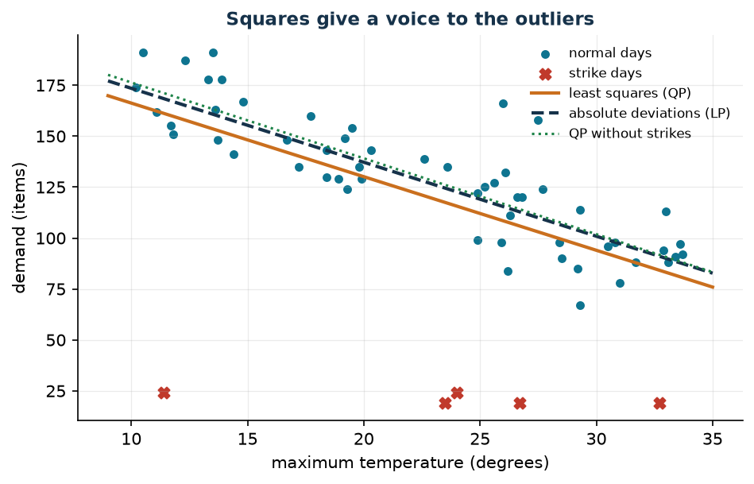
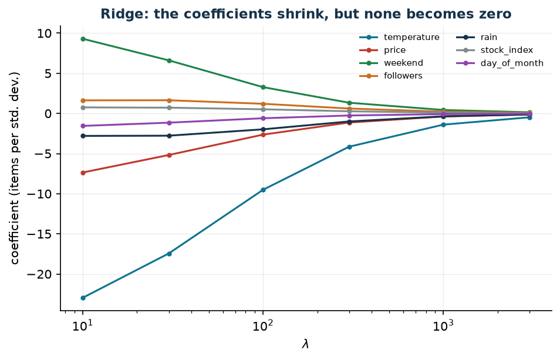

# Least-squares regression

[:material-file-pdf-box: Lecture notes (PDF)](pdf/nlp-modelling-notes.pdf) · [:material-presentation: Chapter slides (PDF)](pdf/slides-13-least-squares.pdf) · [:material-pencil: Exercises](#exercises) · [:material-gesture-tap: App: Least squares versus least absolute deviations](lab/least-squares-vs-lp.md)

**Class:** convex QP · **Script:** `python/lab13_least_squares.py`

[](https://colab.research.google.com/github/fabiofurini/nlp-modelling/blob/main/notebooks/lab13_least_squares.ipynb)

!!! nota "Prerequisites"

    - From the module *LP Modelling*, [Chapter 11 «Robust and quantile regression: estimating parameters with an LP»](https://fabiofurini.github.io/lp-modelling/regression/): regression with absolute deviations and quantiles as an LP, on the same data.

    - From this module, [Chapter 2 «Background: convexity, quadratic programming and KKT conditions»](https://fabiofurini.github.io/nlp-modelling/theory-nonlinear/): convex quadratic programs, the KKT conditions and the multipliers as shadow prices.

    - From the module *Linear Algebra*, [Chapter 6 «System of linear equations»](https://fabiofurini.github.io/linear-algebra/systems/01-linear-systems/): linear systems, which give the normal equations.

!!! chiave "Objectives"

    At the end of this chapter you will be able to:

    - write least squares as a QP;

    - read the KKT conditions as the normal equations;

    - compare least squares, absolute deviations and quantiles on the same data;

    - shrink the coefficients with a quadratic penalty (ridge).

The case, the data and the linear model are those of
[LP Modelling, "Robust and quantile regression"](https://fabiofurini.github.io/lp-modelling/regression/):
sixty days of sales of a bakery, five of them during two strikes. There the sum of
the **absolute** deviations is minimized (an LP); here the sum of the **squared**
deviations: least squares, a convex QP.

## Model

**What changes.** The data are those of the linear model ($n$ observations, $p$
features, values $x_{ij}$, observations $y_i$); the quantile $\tau$ is not needed.
We introduce $p + 1$ free variables $w_j$ and $b$ and a free residual $r_i$ for every
observation. The QP model of least squares is the following:

$$
\begin{aligned}
\min ~~ \sum_{i=1}^{n} r_i^{2} & & \\
\text{subject to} \quad \sum_{j=1}^{p} w_j\, x_{ij} + b + r_i &= y_i, & \forall i \in \{1, 2, \dots, n\}, \\
w_j &\gtreqless 0, & \forall j \in \{1, 2, \dots, p\}, \\
b &\gtreqless 0, & \\
r_i &\gtreqless 0, & \forall i \in \{1, 2, \dots, n\}.
\end{aligned}
$$

Description of the objective function and of the constraints:

- the quadratic objective function adds up the squares of the residuals;
- the linear constraints define the residual of every observation ($n$ linear
  constraints);
- the variables are all free: the square does not distinguish the sign, and the two
  positive parts of the linear model are not needed.

!!! example "Worked example (without features: the mean comes back)"
    Seven sales: 88, 96, 104, 112, 120, 132, 148. The solver gives
    $\tilde b = 800/7 = 114.2857$, $\tilde z = 2619.4286$ and multipliers
    $\tilde\pi_i = 2\tilde r_i$. Stationarity in $b$ gives $\sum_i r_i = 0$: the
    estimate is the **mean**. On the same numbers robust regression gives the median
    112 and quantile regression ($\tau = 9/13$) gives 120. If the last value becomes
    248, the mean rises by 14.29; the median stays at 112.

!!! note "The KKT conditions are the normal equations"
    $\pi_i = 2 r_i$, $\sum_i r_i = 0$, $\sum_i r_i\, x_{ij} = 0$ for every $j$:
    residuals summing to zero and orthogonal to every feature. The multiplier is twice
    the residual: a distant datum weighs as much as it is distant.

## Case study

```text
QP (least squares)         : demand = 202.34 - 3.61 * temperature
LP (absolute deviations)   : demand = 209.77 - 3.63 * temperature
QP without the strike days : demand = 213.58 - 3.72 * temperature
Mean absolute deviation on the 55 normal days: QP 14.81  LP 13.08  clean QP 13.05
Share of the sum of squares due to the 5 strike days: 71.4%
```



Five days out of sixty produce 71% of the sum of squares: least squares must come with
a check for outliers, robust regression does not.

**Forecast for the newsvendor** (55 normal days, three features):

```text
Typical day (28 degrees, price 3.00, weekend):
  forecast mean (QP)                   128.7 items
  mean + z*sigma, z = 0.5024           133.5 items
  forecast 9/13 quantile (LP)          132.1 items
```

Mean plus $z\sigma$ assumes normal residuals; quantile regression estimates the
quantile with no assumption on the shape of the errors.

## Sensitivity

```text
shift           QP: b      w         LP: b      w
      0       213.58  -3.723        210.49  -3.578
    -50       217.09  -3.918        211.63  -3.689
   -100       220.59  -4.113        211.63  -3.689
   -200       227.60  -4.503        211.63  -3.689
```

Moving the demand of the hottest normal day, the QP estimate moves in proportion to the
error; the LP estimate changes once and then stops.

**Ridge regression.** With $\lambda \sum_j w_j^2$ in the objective (still a convex QP)
the coefficients shrink, but none becomes zero; the budget on the absolute values of
LP Modelling, instead, leaves out the useless features.



## In summary

!!! chiave "In summary"

    - Least squares is a convex QP, and its KKT conditions are the normal equations.

    - It estimates the mean: excellent with symmetric errors, fragile with outliers, where absolute deviations hold better.

    - For the newsvendor one uses the mean plus a stock, or the quantile directly.

    - Ridge stabilizes the coefficients; a linear budget on them selects the features.

## Code

The full script of the chapter is
[`python/lab13_least_squares.py`](https://github.com/fabiofurini/nlp-modelling/blob/main/python/lab13_least_squares.py)
(reproducible with `python3 lab13_least_squares.py` from the `python/` folder); the
same code is in the notebook that opens in Colab from the badge at the top of the page.

??? example "Show the full script — `lab13_least_squares.py`"

    ```python
    """Chapter 13 — Least-squares regression (convex QP).

    Case study: the same as robust and quantile regression (LP Modelling):
    sixty days of sales of a bakery (demand, temperature, price, weekend),
    five of them during two transport strikes.

    Contents:
      1. Without features the QP returns the mean (worked example)
      2. Data (the same as in the linear case)
      3. Least squares (QP) against absolute deviations (LP): robustness to outliers
      4. Reading the KKT conditions: residuals, multipliers and normal equations
      5. Forecast for the newsvendor: mean plus safety stock against quantile regression
      6. Sensitivity: a single outlying day and ridge regression
    """
    import gurobipy as gp
    import numpy as np
    import pandas as pd
    from gurobipy import GRB
    from statistics import NormalDist

    from stile import (ARANCIO, BLU, GRIGIO, ROSSO, TEAL, VERDE, intestazione, plt,
                       salva_dat, salva_dati, salva_figura)

    TAU_NV = 9 / 13                                # critical fractile of the bakery


    # ----------------------------------------------------------------------
    # MODELS: least squares (QP) and, for comparison, quantile regression (LP)
    # ----------------------------------------------------------------------
    def minimi_quadrati(X, y, lam=0.0):
        """min sum_i r_i^2 + lam * sum_j w_j^2  s.t.  X w + b + r = y  (convex QP)."""
        n, p = X.shape
        m = gp.Model("least_squares")
        m.Params.OutputFlag = 0
        w = m.addVars(p, lb=-GRB.INFINITY, name="w")
        b = m.addVar(lb=-GRB.INFINITY, name="b")
        r = m.addVars(n, lb=-GRB.INFINITY, name="r")
        residuo = m.addConstrs(
            (gp.quicksum(X[i, j] * w[j] for j in range(p)) + b + r[i] == y[i] for i in range(n)),
            name="residual")
        m.setObjective(gp.quicksum(r[i] * r[i] for i in range(n))
                       + lam * gp.quicksum(w[j] * w[j] for j in range(p)), GRB.MINIMIZE)
        m.optimize()
        assert m.Status == GRB.OPTIMAL
        return (m, np.array([w[j].X for j in range(p)]), b.X,
                np.array([r[i].X for i in range(n)]), np.array([residuo[i].Pi for i in range(n)]))


    def regressione_quantile(X, y, tau=0.5):
        """min sum_i [tau u_i + (1-tau) v_i]  s.t.  X w + b + u - v = y  (LP)."""
        n, p = X.shape
        m = gp.Model("quantile")
        m.Params.OutputFlag = 0
        w = m.addVars(p, lb=-GRB.INFINITY, name="w")
        b = m.addVar(lb=-GRB.INFINITY, name="b")
        u = m.addVars(n, name="u")
        v = m.addVars(n, name="v")
        m.addConstrs((gp.quicksum(X[i, j] * w[j] for j in range(p)) + b + u[i] - v[i] == y[i]
                      for i in range(n)), name="residual")
        m.setObjective(gp.quicksum(tau * u[i] + (1 - tau) * v[i] for i in range(n)), GRB.MINIMIZE)
        m.optimize()
        assert m.Status == GRB.OPTIMAL
        return np.array([w[j].X for j in range(p)]), b.X


    def scarto_medio(X, y, coef, b):
        return float(np.abs(y - (X @ coef + b)).mean())


    # ----------------------------------------------------------------------
    # 1. WITHOUT FEATURES: THE QP RETURNS THE MEAN
    # ----------------------------------------------------------------------
    intestazione("No features: the mean (worked example)")
    y7 = np.array([88.0, 96.0, 104.0, 112.0, 120.0, 132.0, 148.0])
    m0, _, b0, r0, pi0 = minimi_quadrati(np.zeros((7, 0)), y7)
    print(f"Seven days: {y7.astype(int)}")
    print(f"Optimal intercept b = {b0:.4f}  (mean = {y7.mean():.4f} = 800/7)")
    print(f"Optimal value = {m0.ObjVal:.4f}")
    print(f"Residuals r = {np.round(r0, 4)}  sum = {r0.sum():.6f}")
    print(f"Duals  pi = {np.round(pi0, 4)}  (= 2 r_i)  sum = {pi0.sum():.6f}")
    _, bq_med = regressione_quantile(np.zeros((7, 0)), y7, tau=0.5)
    _, bq_nv = regressione_quantile(np.zeros((7, 0)), y7, tau=TAU_NV)
    print(f"Comparison: median (LP, tau = 1/2) = {bq_med:.1f}; 9/13 quantile (LP) = {bq_nv:.1f}")
    y7b = y7.copy(); y7b[-1] = 248.0
    _, _, b0b, _, _ = minimi_quadrati(np.zeros((7, 0)), y7b)
    _, bqb = regressione_quantile(np.zeros((7, 0)), y7b, tau=0.5)
    print(f"If the last value goes from 148 to 248: mean {b0b:.4f} (+{b0b - b0:.4f}), "
          f"median {bqb:.1f} (unchanged)")

    # ----------------------------------------------------------------------
    # 2. DATA (the same as in the linear case: same generator, same seed)
    # ----------------------------------------------------------------------
    # The data are those of the linear case in LP Modelling: they are written here (same seed),
    # so that the script also runs in Colab; the CSV files live in the LP Modelling repository.
    intestazione("The bakery history: 60 days")
    rng = np.random.default_rng(16)
    n = 60
    temperatura = np.round(rng.uniform(10, 34, n), 1)
    prezzo = rng.choice([2.20, 2.60, 3.00, 3.40], n)
    weekend = (rng.random(n) < 0.30).astype(float)
    domanda = (258 - 3.7 * temperatura - 19.0 * prezzo + 33.0 * weekend
               + rng.normal(0, 9, n))
    anomalo = np.zeros(n)
    giorni_sciopero = [11, 22, 29, 41, 46]         # two transport strikes
    domanda[giorni_sciopero] = rng.uniform(18, 32, len(giorni_sciopero))
    anomalo[giorni_sciopero] = 1
    domanda = np.round(domanda).astype(float)
    follower = np.round(rng.uniform(8, 20, n), 1)
    pioggia = np.round(rng.uniform(0, 12, n), 1)
    borsa = np.round(rng.uniform(95, 115, n), 1)
    giorno_mese = rng.integers(1, 29, n).astype(float)

    print(f"Demand: min {domanda.min():.0f}, mean {domanda.mean():.1f}, "
          f"max {domanda.max():.0f}   strike days: {[g + 1 for g in giorni_sciopero]}")

    # ----------------------------------------------------------------------
    # 3. LEAST SQUARES (QP) AGAINST ABSOLUTE DEVIATIONS (LP)
    # ----------------------------------------------------------------------
    intestazione("Least squares (QP) against absolute deviations (LP)")
    Xt = temperatura.reshape(-1, 1)
    buoni = anomalo == 0
    m_ls, w_ls, b_ls, r_ls, pi_ls = minimi_quadrati(Xt, domanda)
    w_lad, b_lad = regressione_quantile(Xt, domanda, tau=0.5)
    _, w_pul, b_pul, _, _ = minimi_quadrati(Xt[buoni], domanda[buoni])
    print(f"QP  (least squares)      : demand = {b_ls:.2f} {w_ls[0]:+.2f} * temperature")
    print(f"LP  (absolute deviations): demand = {b_lad:.2f} {w_lad[0]:+.2f} * temperature")
    print(f"QP without the 5 strike days: demand = {b_pul:.2f} {w_pul[0]:+.2f} * temperature")
    print(f"Sum of squares: {m_ls.ObjVal:.1f}   root mean squared error "
          f"{np.sqrt(m_ls.ObjVal / n):.2f} items")
    print(f"Mean absolute deviation on the 55 normal days: QP {scarto_medio(Xt[buoni], domanda[buoni], w_ls, b_ls):.2f}, "
          f"LP {scarto_medio(Xt[buoni], domanda[buoni], w_lad, b_lad):.2f}, "
          f"clean QP {scarto_medio(Xt[buoni], domanda[buoni], w_pul, b_pul):.2f} items")
    quota = (r_ls[~buoni] ** 2).sum() / m_ls.ObjVal
    print(f"Share of the sum of squares due to the 5 strike days: {100 * quota:.1f}%")

    # ----------------------------------------------------------------------
    # 4. READING THE KKT: RESIDUALS, MULTIPLIERS, NORMAL EQUATIONS
    # ----------------------------------------------------------------------
    intestazione("KKT conditions of least squares")
    print(f"max |pi_i - 2 r_i| = {np.abs(pi_ls - 2 * r_ls).max():.2e}")
    print(f"sum of the residuals           = {r_ls.sum():.6f}  (stationarity in b)")
    print(f"sum of residuals * temperature = {(r_ls * temperatura).sum():.6f}  (in w)")
    A = np.column_stack([np.ones(n), temperatura])
    coef_ne = np.linalg.solve(A.T @ A, A.T @ domanda)
    print(f"Normal equations (A'A) c = A'y: b = {coef_ne[0]:.2f}, w = {coef_ne[1]:+.2f}  "
          f"(the same as the QP)")
    print(f"Residuals of the strike days: {np.round(r_ls[~buoni], 1)}")
    print(f"Largest absolute residual among the normal days: {np.abs(r_ls[buoni]).max():.1f}")

    # ----------------------------------------------------------------------
    # 5. FORECAST FOR THE NEWSVENDOR: MEAN + SAFETY STOCK AGAINST QUANTILE
    # ----------------------------------------------------------------------
    intestazione("Three features on the 55 normal days: mean and quantile")
    X3 = np.column_stack([temperatura, prezzo, weekend])[buoni]
    y3 = domanda[buoni]
    _, w3, b3, r3, _ = minimi_quadrati(X3, y3)
    w3q, b3q = regressione_quantile(X3, y3, tau=TAU_NV)
    sigma = float(np.sqrt((r3 ** 2).sum() / (len(y3) - 4)))
    print(f"Least squares: demand = {b3:.2f} {w3[0]:+.2f}*temp {w3[1]:+.2f}*price "
          f"{w3[2]:+.2f}*weekend   (sigma of the residuals {sigma:.2f})")
    print(f"9/13 quantile: demand = {b3q:.2f} {w3q[0]:+.2f}*temp {w3q[1]:+.2f}*price "
          f"{w3q[2]:+.2f}*weekend")
    giorno_tipo = np.array([28.0, 3.00, 1.0])
    media_prev = float(giorno_tipo @ w3 + b3)
    z = NormalDist().inv_cdf(TAU_NV)
    print(f"Typical day (28 degrees, price 3.00, weekend):")
    print(f"  forecast mean (QP)                {media_prev:6.1f} items")
    print(f"  mean + z*sigma, z = {z:.4f}       {media_prev + z * sigma:6.1f} items")
    print(f"  forecast 9/13 quantile (LP)       {float(giorno_tipo @ w3q + b3q):6.1f} items")
    quota_sotto = float((y3 < X3 @ w3 + b3 + z * sigma - 1e-9).mean())
    print(f"  share of the 55 days below mean + z*sigma: {quota_sotto:.3f} (target {TAU_NV:.3f})")

    # ----------------------------------------------------------------------
    # 6. SENSITIVITY: ONE OUTLYING DAY AND RIDGE REGRESSION
    # ----------------------------------------------------------------------
    intestazione("Sensitivity: a single outlying day")
    k = int(np.argmax(temperatura[buoni]))          # the hottest normal day (high leverage)
    print(f"Day moved: the hottest normal day ({temperatura[buoni][k]:.1f} degrees, "
          f"demand {domanda[buoni][k]:.0f})")
    righe = []
    for delta in (0, -50, -100, -150, -200):
        yy = domanda[buoni].copy()
        yy[k] += delta
        _, wq, bq, _, _ = minimi_quadrati(Xt[buoni], yy)
        wl, bl = regressione_quantile(Xt[buoni], yy, tau=0.5)
        righe.append((delta, bq, wq[0], bl, wl[0]))
        print(f"  demand moved by {delta:5d}: QP b = {bq:7.2f}, w = {wq[0]:+.3f}   "
              f"LP b = {bl:7.2f}, w = {wl[0]:+.3f}")
    salva_dati(pd.DataFrame(righe, columns=["shift", "b_qp", "w_qp", "b_lp", "w_lp"]),
               "minimi_quadrati_anomalo")

    intestazione("Ridge regression: quadratic penalty on the coefficients")
    nomi = ["temperature", "price", "weekend", "followers", "rain", "stock_index", "day_of_month"]
    Xg = np.column_stack([temperatura, prezzo, weekend, follower, pioggia, borsa, giorno_mese])[buoni]
    Xs = (Xg - Xg.mean(axis=0)) / Xg.std(axis=0)    # standardization is mandatory
    percorso = []
    for lam in (0, 10, 30, 100, 300, 1000, 3000):
        _, wr, br, rr, _ = minimi_quadrati(Xs, y3, lam=lam)
        rmse = float(np.sqrt((rr ** 2).mean()))
        percorso.append({"lambda": lam, "rmse": rmse, **{nm: wr[j] for j, nm in enumerate(nomi)}})
        nulli = int((np.abs(wr) < 1e-6).sum())
        print(f"  lambda = {lam:5d}: " + " ".join(f"{c:+7.2f}" for c in wr)
              + f"   rmse {rmse:6.2f}   zero coefficients {nulli}")
    percorso = pd.DataFrame(percorso)
    salva_dati(percorso, "minimi_quadrati_ridge")
    print("  (order: " + ", ".join(nomi) + ")")

    # ----------------------------------------------------------------------
    # 7. FIGURES
    # ----------------------------------------------------------------------
    salva_dat(pd.DataFrame({"temperatura": temperatura, "domanda": domanda,
                            "sciopero": anomalo.astype(int)}), "cap13_panetteria")
    salva_dat(percorso[percorso["lambda"] > 0].assign(loglam=np.log10(percorso["lambda"][1:])),
              "cap13_ridge")

    fig, ax = plt.subplots()
    ax.scatter(temperatura[buoni], domanda[buoni], s=18, color=TEAL, label="normal days")
    ax.scatter(temperatura[~buoni], domanda[~buoni], s=45, color=ROSSO, marker="X",
               label="strike days")
    gr = np.linspace(9, 35, 2)
    ax.plot(gr, b_ls + w_ls[0] * gr, color=ARANCIO, lw=2, label="least squares (QP)")
    ax.plot(gr, b_lad + w_lad[0] * gr, color=BLU, lw=2, ls="--", label="absolute deviations (LP)")
    ax.plot(gr, b_pul + w_pul[0] * gr, color=VERDE, lw=1.5, ls=":", label="QP without strikes")
    ax.set_xlabel("maximum temperature (degrees)"); ax.set_ylabel("demand (items)")
    ax.set_title("Squares give a voice to the outliers")
    ax.legend(loc="upper right", fontsize=8)
    salva_figura(fig, "cap13_minimi_quadrati")

    fig, ax = plt.subplots()
    p2 = percorso[percorso["lambda"] > 0]
    for j, nm in enumerate(nomi):
        ax.plot(p2["lambda"], p2[nm], "-o", ms=3, label=nm, color=[TEAL, ROSSO, VERDE, ARANCIO, BLU, GRIGIO, "#8E44AD"][j])
    ax.set_xscale("log")
    ax.set_xlabel("$\\lambda$"); ax.set_ylabel("coefficient (items per std. dev.)")
    ax.set_title("Ridge: the coefficients shrink, but none becomes zero")
    ax.legend(fontsize=7, ncol=2)
    salva_figura(fig, "cap13_ridge")

    print("\nDone: chapter 13.")
    ```

## Exercises

1. **By hand** — sum of the squared residuals for $b = 112$ and for $b = 800/7$.
2. **Normal equations** — solve them for the line with temperature alone on the 55
   normal days and compare with the QP.
3. **Weights** — weight 0.01 on the strike days, on the 60 days with temperature alone.
4. **Huber** — quadratic loss up to 20 and linear beyond, written as a QP.
5. **Validation** — estimate on the first 40 days, test on the remaining 20 without
   strikes.
