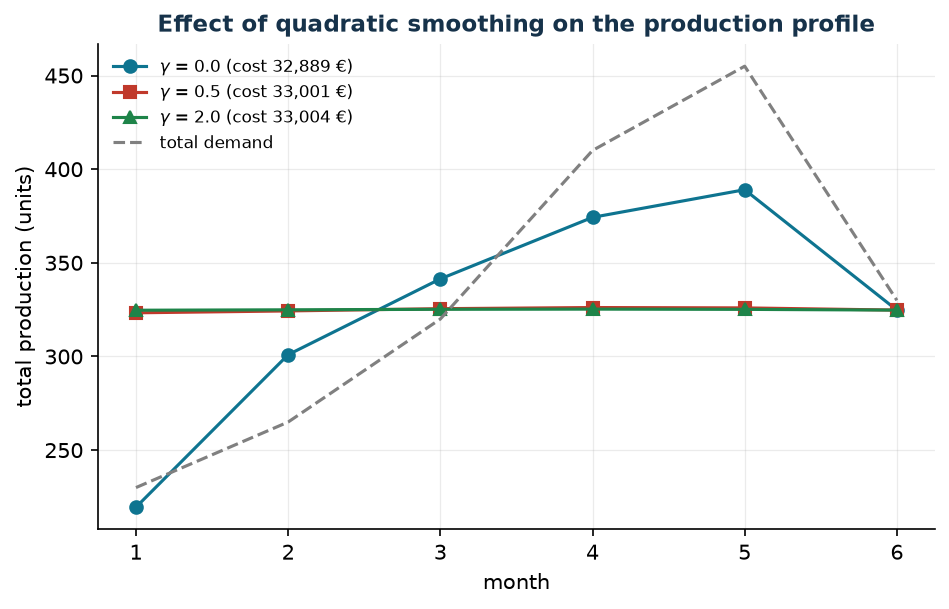
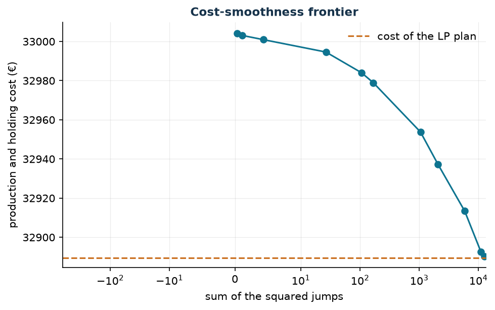

# Production with quadratic smoothing

[:material-file-pdf-box: Lecture notes (PDF)](pdf/nlp-modelling-notes.pdf) · [:material-presentation: Chapter slides (PDF)](pdf/slides-04-production-quadratic.pdf) · [:material-pencil: Exercises](#exercises)

**Class:** convex QP · **Script:** `python/lab04_production_quadratic.py`

[](https://colab.research.google.com/github/fabiofurini/nlp-modelling/blob/main/notebooks/lab04_production_quadratic.ipynb)

!!! nota "Prerequisites"

    - From the module *LP Modelling*, [Chapter 4 «Multi-period production and inventory»](https://fabiofurini.github.io/lp-modelling/production/): the linear production and inventory model, with its data.

    - From this module, [Chapter 2 «Background: convexity, quadratic programming and KKT conditions»](https://fabiofurini.github.io/nlp-modelling/theory-nonlinear/): convex quadratic programs, the KKT conditions and the multipliers as shadow prices.

    - From this module, [Chapter 3 «The solver for nonlinear models»](https://fabiofurini.github.io/nlp-modelling/solver-nonlinear/): quadratic objectives and the multipliers of a QP in `gurobipy`.

!!! chiave "Objectives"

    At the end of this chapter you will be able to:

    - add a convex quadratic term to a linear model;

    - read the multipliers of a QP and verify them by perturbation;

    - trace the cost-smoothness frontier as the weight varies.

The case, the data and the linear model are those of
[LP Modelling, "Production and inventory"](https://fabiofurini.github.io/lp-modelling/production/).
The minimum-cost plan changes pace abruptly: total production goes from 219.5 to
389.0 units, with jumps of up to 81.4 units in a month. Here a **quadratic** penalty
on the jumps of total production is added to the objective: a jump twice as large
costs four times as much.

## Model

**What changes.** Data, variables and constraints are those of the linear model
($x_{it}$ production, $s_{it}$ stock, demand $d_{it}$, costs $c_{it}$ and $h_{it}$,
hours $a_i$, capacity $b_t$). A single datum is added:

| Symbol | Type | Meaning |
|---|---|---|
| $\gamma$ | $\in \mathbb{Q}_{\ge 0}$ | weight of the jumps of total production (€ per unit²) |

Using the same variables, a QP model for the problem is the following:

$$
\begin{aligned}
\min ~~ \sum_{i=1}^{n} \sum_{t=1}^{m} \bigl( c_{it}\, x_{it} + h_{it}\, s_{it} \bigr) + \gamma \sum_{t=2}^{m} \Bigl( \sum_{i=1}^{n} x_{it} - \sum_{i=1}^{n} x_{i,t-1} \Bigr)^{2} & & \\
\text{subject to} \quad s_{i,t-1} + x_{it} &= d_{it} + s_{it}, & \forall i \in \{1, 2, \dots, n\},~\forall t \in \{1, 2, \dots, m\}, \\
\sum_{i=1}^{n} a_i\, x_{it} &\le b_t, & \forall t \in \{1, 2, \dots, m\}, \\
x_{it} &\ge 0, & \forall i \in \{1, 2, \dots, n\},~\forall t \in \{1, 2, \dots, m\}, \\
s_{it} &\ge 0, & \forall i \in \{1, 2, \dots, n\},~\forall t \in \{1, 2, \dots, m\}.
\end{aligned}
$$

Description of the objective function and of the constraints:

- the quadratic objective function adds to the production and holding cost the weight
  $\gamma$ times the square of every jump of total production;
- the linear **balance** constraints of the inventory ($n\,m$ linear constraints);
- the linear **capacity** constraints ($m$ linear constraints);
- the non-negativity constraints define the variables of the model.

The QP is **convex**: every jump is linear in the variables, its square is convex
and the constraints are linear. With $\gamma = 0$ we recover the linear model.

!!! example "Worked example (1 product, 2 months)"
    $d = (60, 100)$, $c = 10$, $h = 1$, ample capacity; the linear model produces to
    demand, cost $1600$. With $\gamma = 0.5$ the solver gives
    $\tilde x = (79.75;\ 80.25)$, $\tilde s_1 = 19.75$, $\tilde z = 1619.875$ and
    balance multipliers $(9.5;\ 10.5)$. From the balances the jump is $40 - 2s_1$ and
    the objective $f(s_1) = 1600 + s_1 + \gamma(40 - 2s_1)^2$: $f'(s_1) = 0$ gives
    $s_1 = 20 - 1/(8\gamma)$. For $\gamma \le 1/160$ it pays to keep no stock. With
    positive stock the KKT conditions give $\tilde\pi_2 - \tilde\pi_1 = h$.

## Results

```text
gamma = 0.0: objective 32,889.33  linear cost 32,889.33  largest jump 81.4
   total production:  219.5  301.0  341.4  374.3  389.0  324.8
gamma = 0.5: objective 33,003.10  linear cost 33,000.96  largest jump  1.2
   total production:  323.3  324.3  325.5  326.1  325.9  324.8
gamma = 2.0: objective 33,004.74  linear cost 33,004.14  largest jump  0.4
```



The smooth plan costs €111.63 more than the linear plan (+0.34%). Mostly product 1
goes to stock, up to 212.6 units: the penalty counts **units**, not hours, and product
1 gives more units per machine hour ($a_1 = 0.9$). In the linear model the stock built
in advance was that of product 3.

## Sensitivity

```text
month 4: Pi(gamma=0) = -2.286   Pi(gamma=0.5) = -0.667 EUR/hour
month 5: Pi(gamma=0) = -3.048   Pi(gamma=0.5) = -1.333 EUR/hour
month 6: Pi(gamma=0) = -3.810   Pi(gamma=0.5) = -3.134 EUR/hour
Check: +1    hour  in month 6 -> difference quotient -3.060
Check: +0.01 hours in month 6 -> difference quotient -3.133
```

!!! note "The multiplier of a QP is exact only at the margin"
    In the QP the optimal value has curvature: with a whole hour the change is
    $-3.060$, with $0.01$ hours the difference quotient is $-3.133$, that is the
    multiplier. With smoothing the capacity of months 1–3 is no longer active.



!!! tip "Management take-away"
    The first steps towards smoothness cost very little: with $\gamma = 0.01$ the sum
    of the squared jumps falls from 13,699 to 2,075 for €48. An almost flat plan
    costs about €112 out of 33,000.

## In summary

!!! chiave "In summary"

    - A convex quadratic term added to an LP gives a convex QP.

    - The weight $\gamma$ traces the cost-smoothness frontier: the first steps cost little.

    - QP multipliers are read with `Pi`, but they hold at the margin.

    - A new term can change the structure of the solution.

## Code

The full script of the chapter is
[`python/lab04_production_quadratic.py`](https://github.com/fabiofurini/nlp-modelling/blob/main/python/lab04_production_quadratic.py)
(reproducible with `python3 lab04_production_quadratic.py` from the `python/` folder);
the same code is in the notebook that opens in Colab from the badge at the top of the
page.

??? example "Show the full script — `lab04_production_quadratic.py`"

    ```python
    """Chapter 4 — Production with quadratic smoothing (convex QP).

    Case study: the same as the linear production and inventory model
    (LP Modelling): 3 components (products 1, 2, 3), 6 months, one shared
    resource (machine hours). Here a quadratic penalty on the month-to-month
    changes of total production is added to the objective.

    Contents:
      1. Data (the same as in the linear case)
      2. Worked example: one product, two months
      3. The QP on the case study for three values of gamma
      4. Capacity multipliers in the QP and check by perturbation
      5. Sensitivity: the cost-smoothness frontier as gamma varies
    """
    import gurobipy as gp
    import numpy as np
    import pandas as pd
    from gurobipy import GRB

    from stile import ARANCIO, TEAL, intestazione, plt, salva_dat, salva_dati, salva_figura

    # ----------------------------------------------------------------------
    # 1. DATA (the same as in the linear case)
    # ----------------------------------------------------------------------
    # The data are those of the linear case in LP Modelling: they are written here (same seed),
    # so that the script also runs in Colab; the CSV files live in the LP Modelling repository.
    prodotti = ["1", "2", "3"]
    mesi = list(range(1, 7))
    domanda = {
        ("1", 1): 110, ("1", 2): 130, ("1", 3): 150, ("1", 4): 190, ("1", 5): 210, ("1", 6): 160,
        ("2", 1): 70,  ("2", 2): 80,  ("2", 3): 110, ("2", 4): 140, ("2", 5): 150, ("2", 6): 100,
        ("3", 1): 50,  ("3", 2): 55,  ("3", 3): 60,  ("3", 4): 80,  ("3", 5): 95,  ("3", 6): 70,
    }
    costo_prod = {"1": 12.0, "2": 18.0, "3": 25.0}   # €/unit
    costo_giac = {"1": 0.8, "2": 1.2, "3": 1.6}      # €/unit/month
    ore_unit = {"1": 0.9, "2": 1.4, "3": 2.1}        # machine hours per unit
    capacita = {1: 420, 2: 420, 3: 460, 4: 460, 5: 460, 6: 420}  # hours/month
    scorta_iniziale = {"1": 30, "2": 20, "3": 10}


    def costruisci_qp(gamma, cap=None):
        """QP: production + holding cost + gamma * sum of the squared jumps."""
        cap = cap or capacita
        m = gp.Model("production_smoothing")
        m.Params.OutputFlag = 0
        x = m.addVars(prodotti, mesi, name="x")           # quantity produced
        s = m.addVars(prodotti, mesi, name="s")           # end-of-month stock
        m.addConstrs(
            ((scorta_iniziale[i] if t == 1 else s[i, t - 1]) + x[i, t] == domanda[i, t] + s[i, t]
             for i in prodotti for t in mesi), name="balance")
        v_cap = m.addConstrs(
            (gp.quicksum(ore_unit[i] * x[i, t] for i in prodotti) <= cap[t] for t in mesi),
            name="capacity")
        tot = {t: gp.quicksum(x[i, t] for i in prodotti) for t in mesi}
        costo = gp.quicksum(costo_prod[i] * x[i, t] + costo_giac[i] * s[i, t]
                            for i in prodotti for t in mesi)
        salti = gp.quicksum((tot[t] - tot[t - 1]) * (tot[t] - tot[t - 1]) for t in mesi[1:])
        m.setObjective(costo + gamma * salti, GRB.MINIMIZE)
        return m, x, s, v_cap


    def leggi(m, x, s):
        """Linear cost, total profile, jumps and sum of the squared jumps."""
        profilo = np.array([sum(x[i, t].X for i in prodotti) for t in mesi])
        salti = np.diff(profilo)
        costo = sum(costo_prod[i] * x[i, t].X + costo_giac[i] * s[i, t].X
                    for i in prodotti for t in mesi)
        return costo, profilo, salti, float((salti ** 2).sum())


    # ----------------------------------------------------------------------
    # 2. WORKED EXAMPLE: ONE PRODUCT, TWO MONTHS
    # ----------------------------------------------------------------------
    intestazione("Worked example: one product, two months (d = 60, 100; c = 10, h = 1)")
    for g in (0.0, 0.004, 0.5):
        me = gp.Model("example")
        me.Params.OutputFlag = 0
        x1, x2, s1 = me.addVar(name="x1"), me.addVar(name="x2"), me.addVar(name="s1")
        b1 = me.addConstr(x1 == 60 + s1, name="bal1")
        b2 = me.addConstr(s1 + x2 == 100, name="bal2")
        me.setObjective(10 * x1 + 10 * x2 + s1 + g * (x2 - x1) * (x2 - x1), GRB.MINIMIZE)
        me.optimize()
        print(f"  gamma = {g:5.3f}: x1 = {x1.X:7.3f}  x2 = {x2.X:7.3f}  s1 = {s1.X:6.3f}  "
              f"cost = {me.ObjVal:9.4f}  Pi = ({b1.Pi:.4f}, {b2.Pi:.4f})")
    print(f"  threshold: s1 > 0 only if gamma > 1/160 = {1 / 160:.5f}; "
          f"with gamma = 0.5: s1 = 20 - 1/(8 gamma) = {20 - 1 / (8 * 0.5):.2f}")

    # ----------------------------------------------------------------------
    # 3. THE QP ON THE CASE STUDY
    # ----------------------------------------------------------------------
    intestazione("QP on the case study: three values of gamma")
    GAMMA = [0.0, 0.5, 2.0]
    risultati = {}
    for g in GAMMA:
        m, x, s, v_cap = costruisci_qp(g)
        m.optimize()
        assert m.Status == GRB.OPTIMAL
        costo, profilo, salti, sq = leggi(m, x, s)
        risultati[g] = dict(obj=m.ObjVal, costo=costo, profilo=profilo, salti=salti, sq=sq,
                            piano={(i, t): x[i, t].X for i in prodotti for t in mesi},
                            scorte={(i, t): s[i, t].X for i in prodotti for t in mesi},
                            pi=[v_cap[t].Pi for t in mesi])
        print(f"gamma = {g:3.1f}: objective {m.ObjVal:10.2f} €  linear cost {costo:10.2f} €  "
              f"largest jump {np.abs(salti).max():6.1f}  sum of jumps^2 {sq:9.1f}")
        print("   total production: " + "  ".join(f"{v:6.1f}" for v in profilo))

    r5 = risultati[0.5]
    print(f"\nCost of smoothness (gamma = 0.5): {r5['costo'] - risultati[0.0]['costo']:.2f} € "
          f"(+{100 * (r5['costo'] / risultati[0.0]['costo'] - 1):.2f}%)")
    print("\nPlan with gamma = 0.5 (units/month):")
    piano5 = pd.DataFrame([(i, t, r5["piano"][i, t], r5["scorte"][i, t]) for i in prodotti for t in mesi],
                          columns=["product", "month", "production", "stock"])
    print(piano5.pivot(index="product", columns="month", values="production").round(1))
    print("End-of-month stocks:")
    print(piano5.pivot(index="product", columns="month", values="stock").round(1))
    salva_dati(piano5, "produzione_piano_regolare")

    # ----------------------------------------------------------------------
    # 4. CAPACITY MULTIPLIERS IN THE QP
    # ----------------------------------------------------------------------
    intestazione("Capacity multipliers (gamma = 0 and gamma = 0.5)")
    for t in mesi:
        print(f"  month {t}: Pi(gamma=0) = {risultati[0.0]['pi'][t - 1]:7.3f}   "
              f"Pi(gamma=0.5) = {r5['pi'][t - 1]:7.3f} €/hour")
    t_star = int(np.argmin(r5["pi"])) + 1
    for eps in (1.0, 0.01):
        cap2 = dict(capacita)
        cap2[t_star] += eps
        m2, x2_, s2_, _ = costruisci_qp(0.5, cap2)
        m2.optimize()
        print(f"Check: +{eps:g} hours in month {t_star} -> objective from {r5['obj']:.3f} to {m2.ObjVal:.3f} "
              f"(difference quotient {(m2.ObjVal - r5['obj']) / eps:+.3f}; Pi = {r5['pi'][t_star - 1]:.3f})")

    # ----------------------------------------------------------------------
    # 5. SENSITIVITY: COST-SMOOTHNESS FRONTIER
    # ----------------------------------------------------------------------
    intestazione("Cost-smoothness frontier as gamma varies")
    griglia = [0.0, 0.001, 0.002, 0.005, 0.01, 0.02, 0.05, 0.1, 0.2, 0.5, 1.0, 2.0]
    frontiera = []
    for g in griglia:
        m, x, s, _ = costruisci_qp(g)
        m.optimize()
        costo, profilo, salti, sq = leggi(m, x, s)
        frontiera.append((g, costo, sq, float(np.abs(salti).max())))
        print(f"  gamma = {g:6.3f}: cost {costo:10.2f} €  sum of jumps^2 {sq:9.1f}  "
              f"largest jump {np.abs(salti).max():6.1f}")
    front = pd.DataFrame(frontiera, columns=["gamma", "cost", "squared_jumps", "largest_jump"])
    salva_dati(front, "produzione_frontiera_regolarita")

    # ----------------------------------------------------------------------
    # 6. FIGURES (data for pgfplots + matplotlib preview)
    # ----------------------------------------------------------------------
    salva_dat(pd.DataFrame({
        "mese": mesi,
        "gzero": risultati[0.0]["profilo"], "gmezzo": risultati[0.5]["profilo"],
        "gdue": risultati[2.0]["profilo"],
        "domtot": [sum(domanda[i, t] for i in prodotti) for t in mesi],
    }), "cap04_smoothing")
    salva_dat(front[front["gamma"] > 0], "cap04_frontiera")

    fig, ax = plt.subplots()
    for g, st in zip(GAMMA, ["-o", "-s", "-^"]):
        ax.plot(mesi, risultati[g]["profilo"], st,
                label=f"$\\gamma$ = {g} (cost {risultati[g]['costo']:,.0f} €)")
    ax.plot(mesi, [sum(domanda[i, t] for i in prodotti) for t in mesi], "--", color="gray",
            label="total demand")
    ax.set_xlabel("month"); ax.set_ylabel("total production (units)")
    ax.set_title("Effect of quadratic smoothing on the production profile")
    ax.legend(fontsize=8)
    salva_figura(fig, "cap04_smoothing")

    fig, ax = plt.subplots()
    f2 = front[front["gamma"] > 0]
    ax.plot(f2["squared_jumps"], f2["cost"], "-o", color=TEAL)
    ax.axhline(risultati[0.0]["costo"], color=ARANCIO, ls="--", label="cost of the LP plan")
    ax.set_xscale("symlog", linthresh=10)
    ax.set_xlabel("sum of the squared jumps")
    ax.set_ylabel("production and holding cost (€)")
    ax.set_title("Cost-smoothness frontier")
    ax.legend()
    salva_figura(fig, "cap04_frontiera")

    print("\nDone: chapter 4.")
    ```

## Exercises

1. **By hand** — in the example set $\gamma = 0.05$: compute $s_1$, $x_1$, $x_2$, the
   optimal value and the balance multipliers.
2. **Check** — with $\gamma = 0.5$ verify by perturbation the capacity multiplier of
   month 5 (increments of 1 and of 0.01 hours) and compare with month 6.
3. **Smoothing by product** — penalize the jumps of every product,
   $\gamma \sum_i \sum_t (x_{it} - x_{i,t-1})^2$, with $\gamma = 0.5$.
4. **Linear smoothing** — replace the square with the absolute value (an LP), with
   $\gamma = 5$: what shape does the profile take?
5. **Target level** — penalize $\gamma \sum_t (v_t - 325)^2$ with $\gamma = 0.5$.
